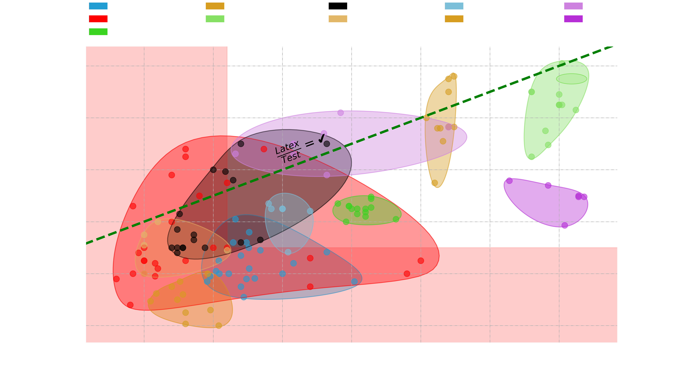
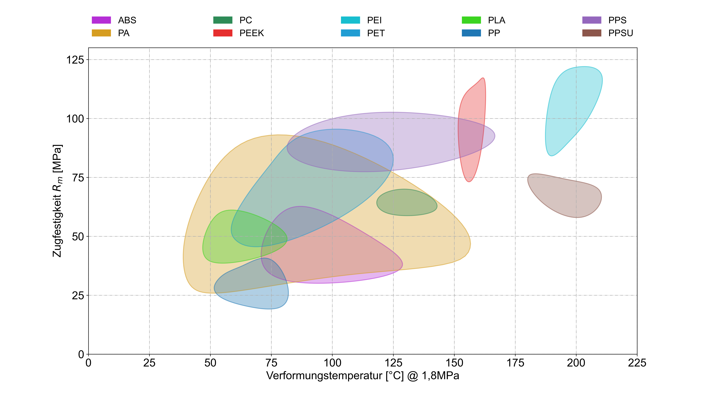

# Ashby plots in python
 Simple script to generate Ashby plots based on generic material property data. This package enables you to:
 * creation of custom guidelines to define material indices (e.g., $\frac{E^{1/2}}{\rho}$),
 * color areas to highlight relevant spots
 * put annotations and markers everywhere
 * filter your data for relevant points
 * export the plot transparent with white font or inset a water mark
 * automatic display area
 * log and semilog spaces
 * 
 * generation of multiple plots at once
 * easy language switch
 * and much more ...
 all the setting can be adjusted in the config.json file

 Here's a sample Ashby plot generated by the package:

 
 

Der source-code stammt ursprüngilich von diesem [GitHub](https://github.com/walgren/Ashby-plots) (MIT-Lizens).
Um den Code ganz auf unsere Bedürfnisse anpassen zu können haben wir ihn auf unser GitLab übernommen.

## Verwendung
1. VSC: Python extension installieren
2. Python interpreter wählen: 
   VSC: Strg+Shift+P → Python:Select Interpreter → Enter Path → Find → .\Ashby\Scrips\python.exe
3. Excel-Tabelle in .\material_properties\ ablegen.
4. Einstellungen in **plot_ashby.py** anpassen (Zeile 50-244) und file über das Dreieck oben rechts ausführen.
5. Der Plot wir in einem Popup erscheinen und kann bei belieben loal gespeichert werden 